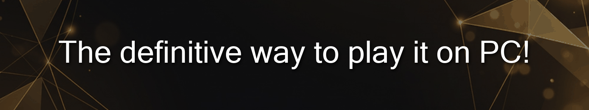

<!-- SPDX-License-Identifier: GPL-2.0-or-later -->
<div align="center">



[Quick start](#quick-start) · [How it works](#how-it-works) · [Features](#features) · [FAQ](#faq) · [Documentation](#documentation) · [Credits](#credits) · [Disclaimer](#disclaimer)

</div>

---

> [!IMPORTANT]
> This repository contains **no game files, keys or firmware**. You need your own legally obtained copy of the PS4 game (the folder that holds `eboot.bin`). Download releases only from this repository's Releases page.

## Quick start

1. Download the latest Windows zip from the **Releases** page and unpack it anywhere (a short path such as `C:\2017RECOMP` is best).
2. Run `pes17launcher.exe`.
3. Press **Install**, choose the folder of your own game dump, and wait a few minutes. The launcher prepares the game once, using the Python that comes in the zip.
4. Press **Play**.

The launcher has four tiles:

| Tile | What it does |
|---|---|
| **Install** | Remembers your game folder and prepares it once (results go to `game-data\`, the log to `game-data\prepare.log`). |
| **Play** | Starts the game. If the preparation has not been done yet, it offers to do it first. |
| **Settings** | Opens the settings window: display, keyboard, controller, audio and online tabs. |
| **Exit** | Closes the launcher. |

Settings are stored in `pes17recomp.ini` next to the programs. Delete the file to go back to the defaults.

### Build it yourself

Prefer to build from source? Follow [BUILDING.md](BUILDING.md): install the MSYS2 CLANG64 packages, clone with `--recursive`, and run `./build.sh`. Building needs Python 3 only for the one-time preparation. [BUILDING.md section 7](BUILDING.md) explains how the release zip is made.

## How it works

2017RECOMP is **not** a source-code recompilation and **not** an emulator of the whole console. It loads the game's own x86-64 code natively and replaces the PS4 system libraries with a small high-level runtime written in C.

```text
 your game dump ──► prepare (Python, once) ──► game-data\
                                                  │
 pes17launcher.exe ──► pes17recomp.exe ◄──────────┘
                            │
        game code (native x86-64) ──► C runtime (files, threads, audio, input)
                            │
                  GNM commands ──► Vulkan renderer derived from shadPS4
```

- **Loader and runtime** (`src/`): maps the game's modules, links its imports to the runtime, and provides the PS4 system calls the game uses.
- **Renderer** (`gpu/`): turns the console's graphics commands into Vulkan, derived from the shadPS4 project.
- **Launcher and settings** (`launcher/`): small Win32 programs written for this project.

[ARCHITECTURE.md](ARCHITECTURE.md) has the details.

## Features

| Area | What you get |
|---|---|
| Frame rate | 60 FPS in menus and gameplay (30 FPS selectable), pre-match cutscenes keep the game's own 30 FPS |
| Display | Windowed, borderless or exclusive fullscreen, output resolution, V-Sync |
| Upscaling | FSR 3.1 (off, or four quality modes) |
| Input | Keyboard with rebinding, and gamepads through SDL3 |
| Audio | Selectable buffer size, ATRAC9 music and sound |
| Saves | Local save data and trophies in a user folder, nothing leaves your PC |

### Known limits of 0.1

This is a first release. Expect rough edges: occasional start-up crashes, a graphics driver reset on some NVIDIA setups, and gameplay that can run slightly fast at 60 FPS. [STATUS.md](STATUS.md) lists the milestones and what is still open.

## FAQ

**Does it include the game?** No. You bring your own dump. Nothing from the game is in this repository or in the release zip.

**Do I need to install Python or MSYS2?** Not with the release zip: Python is bundled and used only for the one-time preparation. You need them only to build from source.

**Which PC do I need?** Windows 10 or 11 (64-bit) and a GPU with a recent Vulkan driver.

**Is it a fork?** No. It is its own code base, derived from the work of the people listed under [Credits](#credits), and it keeps their licence notices.

**Where do my settings and saves go?** Settings in `pes17recomp.ini` next to the programs; saves and trophies in the user folder described in BUILDING.md section 5.

**Something is wrong. What should I include in a report?** The version, your GPU and driver, and the log from `game-data\prepare.log` if the preparation failed. Do not attach game files.

## Documentation

- [BUILDING.md](BUILDING.md): build instructions (MSYS2 CLANG64) and the release zip
- [ARCHITECTURE.md](ARCHITECTURE.md): loader, runtime and GPU layout
- [STATUS.md](STATUS.md): milestone table
- [LEGAL.md](LEGAL.md): what the repository contains and does not contain
- [CONTRIBUTING.md](CONTRIBUTING.md): patch records and the publish check
- [CREDITS.md](CREDITS.md) and [NOTICE](NOTICE): the full credit and licence notes

## Credits

2017RECOMP stands on the work of many people. It is derived from, but is **not a fork of**, the open-source PS4 PC port projects that came before it; their code, ideas and fixes made this possible, and their copyright and licence notices are kept in the files they appear in (see [LICENSES/upstream](LICENSES/upstream) for the exact commits and pull requests).

**The PS4 PC port community**

- **visy** (coroutine and depth-ordering renderer work)
- **Mrsuss60**, whose port led to the staging-read discovery
- **Supermedo** and **d4rksp4rt4n** (texture-pressure fix, red-zone store discovery and trampoline approach)
- **AwesomeObserver** (deferred recording ownership, crash diagnostics, executable cache)
- **Awakenchan** (render scratch pools, tiled writeback, memory remapping and allocation checks)
- **Gerasimos Kanellatos (GerasimosKan)** and **DarkIzuku** (native quit, local trophies, device-aware prompts, mod patch selection, atomic settings)
- The authors of the public performance and stability tree this project was imported from

**Projects and libraries**

- The **shadPS4** project, whose GNM and Vulkan renderer is the foundation of `gpu/`
- The **yuzu**, **Citra**, **Dolphin** and **RPCS3** projects, whose emulation work the renderer builds on
- **AMD** (FidelityFX and GCN headers) and the **FSR-Vulkan** authors
- **sirit**, **Dear ImGui**, **LibAtrac9**, **SDL3**, **FFmpeg**, **Zydis**, **xxHash**, **Christian Rau** (half), the **Khronos Group** (SPIRV-Headers) and the **DejaVu** font authors

If you wrote code that ended up here and are missing from this list, please open an issue and it will be fixed.

## Disclaimer

2017RECOMP is not affiliated with or endorsed by Konami or Sony. Pro Evolution Soccer, PES, PlayStation and related names, logos and marks belong to their owners (Konami Digital Entertainment, Sony Interactive Entertainment) and are named only to identify the game this project works with. No game files, keys or firmware are included or provided. This is not legal advice; read [LEGAL.md](LEGAL.md).

## Contributing

Read [CONTRIBUTING.md](CONTRIBUTING.md) first. Every game-specific patch needs a patch record, and `python scripts/audit_publish.py` must pass before a change is published.

## Licence

GPL-2.0-or-later. See [LICENSE](LICENSE) and [NOTICE](NOTICE). Third-party components keep their own licences, listed in [LICENSES/third-party/INDEX.txt](LICENSES/third-party/INDEX.txt).
